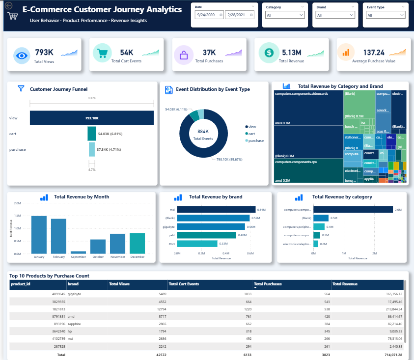

# E-Commerce Customer Journey Analytics

**End-to-End Data Analytics Project | MySQL · SQL · Power BI · DAX**

An end-to-end analytics project exploring customer interactions, purchasing behavior, product performance, and revenue patterns using an electronics e-commerce event dataset.

The project covers data quality assessment, SQL-based transformation, exploratory analysis, KPI development, and interactive business intelligence reporting.

## Dashboard Preview

## Executive Summary

This project analyzes approximately **884K customer interaction events**, including product views, cart additions, and purchases, recorded between September 2020 and February 2021.

The objective is to understand how customers interact with products, evaluate purchasing activity, identify revenue-driving categories and brands, and provide an interactive dashboard for business performance monitoring.

### Key Performance Indicators

| KPI | Dashboard Value |
|---|---:|
| Total Product Views | 793K |
| Total Cart Events | 54K |
| Total Purchase Events | 37K |
| Total Purchase Revenue | 5.13M |
| Average Purchase Event Value | 137.24 |

*Values are rounded as displayed in Power BI. Revenue currency is not independently established.*

## Business Objectives

The analysis addresses five key questions:

1. How are customer interactions distributed across views, cart events, and purchases?
2. Which products, brands, and categories generate the most purchasing activity and revenue?
3. How does purchase revenue change over time?
4. Where might opportunities exist to improve the customer journey?
5. How can data quality and KPI consistency be maintained across SQL and Power BI?

## Tools and Technologies

| Tool | Purpose |
|---|---|
| MySQL | Data import, cleaning, validation, and analytical queries |
| SQL | Aggregation, conditional calculations, distinct counts, date analysis, and revenue reconciliation |
| Power BI | Interactive dashboard development and data visualization |
| DAX | KPI measures and purchase-specific revenue calculations |
| GitHub | Project documentation and portfolio presentation |

## Data Preparation and Cleaning

The dataset was imported into MySQL and processed through three stages:

**1. `events` — Raw Data**

Imported source records and inspected data structure, missing values, duplicates, event types, and price ranges.

**2. `events_clean` — Standardized Data**

- Converted timestamp strings into MySQL DATETIME values.
- Removed unwanted carriage-return characters from session identifiers.
- Standardized blank category, brand, and session fields to SQL NULL values.
- Checked remaining missing values and invalid timestamps.

**3. `events_analysis` — Analytical Dataset**

Created the analysis table using distinct records from the cleaned dataset.

**Data-quality consideration:** Identical event records may represent genuine repeated interactions. Because the dataset does not provide a unique event identifier, deduplication is an analytical assumption and a potential limitation.

## SQL Analysis

The SQL workflow includes:

- Event distribution and customer activity
- Distinct users, products, brands, and sessions
- Purchase counts, purchasing customers, and revenue
- Session-level event comparisons
- Product views and purchasing performance
- Top products and brands by purchase activity and revenue
- Daily revenue and average purchase value
- Missing brand analysis
- Revenue reconciliation using a Common Table Expression (CTE)

**SQL script:** [View the SQL analysis](ecommerce_customer_journey_analysis.sql)

The annotated script contains business questions, SQL queries, and notes explaining important analytical assumptions.

## Power BI Dashboard

The interactive dashboard contains five KPI cards and multiple analytical views.

### Customer Journey Analysis

A funnel-style visualization compares the volume of product views, cart additions, and purchase events.

The event distribution donut chart shows the relative contribution of each event type.

### Revenue and Product Performance

The dashboard includes:

- Monthly purchase revenue trends
- Revenue by category and brand
- Top revenue-generating brands
- Top revenue-generating categories
- Top 10 products ranked by purchase event count

### Interactive Filtering

Users can explore the dashboard using:

- Date range
- Product category
- Brand
- Event type

The filters allow users to investigate different segments of the recorded activity.

## Key Analytical Findings

**1. Product views dominate recorded activity.**

Approximately 793K of the 884K recorded events are product views, making browsing the most frequent observed interaction.

**2. Purchase events represent a smaller share of activity.**

The dashboard records approximately 37K purchases compared with 793K views. This suggests an opportunity to investigate purchasing behavior, but the ratio is not a verified customer conversion rate.

**3. Purchase revenue is not evenly distributed across products and brands.**

Revenue comparisons and product rankings highlight differences in purchasing performance. These can guide further investigation into product demand, pricing, and category-level performance.

**4. Some brand and category information is missing.**

Unattributed records appear in the dashboard. These should remain visible in data-quality reporting rather than being incorrectly assigned to known brands or categories.

**5. Revenue varies across the recorded months.**

Monthly revenue analysis helps identify differences in purchasing activity over time. Additional context would be needed before attributing those changes to seasonality, campaigns, or customer behavior.

## Business Recommendations

- Investigate the customer journey using session-level sequencing to better understand where purchasing activity is lost.
- Prioritize further analysis of products and brands with strong purchasing activity and revenue contributions.
- Monitor missing category and brand information to improve reporting reliability.
- Compare monthly revenue trends alongside purchase counts and average purchase value.
- Extend the analysis with traffic-source, marketing, and customer segmentation data if available.

These recommendations are investigative opportunities, not claims of demonstrated business improvements.

## KPI Definitions

**Total Views:** Number of records where `event_type = 'view'`.

**Total Cart Events:** Number of records where `event_type = 'cart'`.

**Total Purchases:** Number of records where `event_type = 'purchase'`.

**Total Revenue:** Sum of `price` for purchase records only.

**Average Purchase Value:** Total purchase revenue divided by the number of purchase events.

**Important:** A purchase event is not necessarily a complete customer order. Similarly, event-count ratios should not be interpreted as verified session or customer conversion rates.

## Limitations

- Missing brand and category values affect segment-level reporting.
- The analysis table uses exact-row deduplication without a unique event identifier.
- Event counts do not establish a sequential conversion funnel.
- Purchase-event value is used as a revenue proxy, subject to the source dataset's definition of price.
- The dataset does not establish a verified currency.
- Dashboard sparkline decorations are illustrative and should not be interpreted as calculated historical growth rates.
- The available data does not establish causation behind purchasing or revenue patterns.

## Project Files

| File | Description |
|---|---|
| `ecommerce_analysis_annotated.sql` | SQL preparation, validation, and analysis |
| `SQL+pb.png` | Completed Power BI dashboard screenshot |
| `README.md` | Project overview and technical documentation |

The Power BI `.pbix` file and detailed analytical PDF report will be linked when available in the repository.

## Future Enhancements

Potential improvements include session-sequenced conversion analysis, customer segmentation, cohort analysis, additional statistical comparisons, and automated data-quality checks.

---

**Project Focus:** SQL Data Cleaning · Customer Journey Analysis · KPI Development · Revenue Analysis · Power BI Reporting
